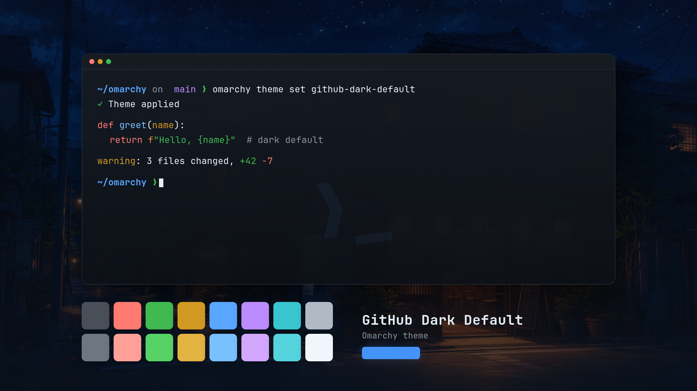
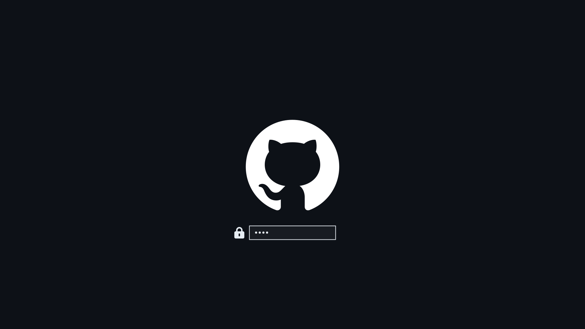

# GitHub Dark Default for Omarchy

[GitHub's dark default theme](https://github.com/primer/github-vscode-theme) for [Omarchy](https://omarchy.org) 4 (Quattro). Colors, terminal ANSI values, and syntax highlighting come from GitHub's [Primer](https://github.com/primer/primitives) design system, so the desktop matches GitHub in the browser and in the editor.



<details>
<summary>Lock screen preview</summary>



</details>

## Install

Omarchy installs a theme from its git URL. Browse the listings at [omarchy.org/themes](https://omarchy.org/themes/) and pass the repository URL:

```bash
omarchy theme install https://github.com/erhahahaa/omarchy-github-dark-default-theme.git
```

This checks out only the files Omarchy reads from a theme: the palette, backgrounds, previews, icons, and per-app color overrides. The repo name resolves to the theme name `github-dark-default`, and Omarchy applies it after cloning. To switch back to it later:

```bash
omarchy theme set github-dark-default
```

Omarchy does not run code shipped by a theme installed from a repository. It takes the palette and the color files, then generates terminal and editor configs from `colors.toml`.

### With the exact terminal and editor configs

The files in `extras/` hold GitHub's exact ANSI palette, the real Neovim colorscheme, and the official VS Code extension. Omarchy only applies them when the theme is user-owned, so copy them in and remove the clone marker:

```bash
git clone https://github.com/erhahahaa/omarchy-github-dark-default-theme.git \
  ~/.config/omarchy/themes/github-dark-default
cp -r ~/.config/omarchy/themes/github-dark-default/extras/. \
  ~/.config/omarchy/themes/github-dark-default/
rm -rf ~/.config/omarchy/themes/github-dark-default/{.git,extras}
omarchy theme set github-dark-default
```

Removing `.git` is intentional. Omarchy only filters themes that still look like a cloned repository, which is how it keeps a downloaded theme from changing what your machine runs. Without `.git`, the theme is yours and every file in it is applied.

> **What changes with the generated configs**
>
> Omarchy's generated terminals map ANSI black to `background` and ANSI white to `foreground`, so `color0` becomes `#0d1117` and `color7` becomes `#e6edf3`. The files in `extras/` use GitHub's own endpoints (`#484f58` and `#b1bac4`), a `#2f81f7` cursor, `github-nvim-theme`, and `GitHub.github-vscode-theme`.
>
> Use the exact-config install above if you want those instead of the generated equivalents.

## What gets themed

| App | Source | Notes |
| --- | --- | --- |
| Omarchy shell: bar, menus, launcher, notifications, OSD, polkit prompt, lock screen | generated | from `colors.toml` |
| Hyprland window borders | generated | blue → purple active gradient, Primer `#30363d` inactive |
| Alacritty, Kitty, Ghostty, Foot | generated, or `extras/` | exact GitHub ANSI palette and cursor from `extras/` |
| Neovim | generated, or `extras/` | `projekt0n/github-nvim-theme` with `github_dark_default` |
| VS Code | generated, or `extras/` | `GitHub.github-vscode-theme` |
| Helix | `helix.toml` | GitHub syntax colors: red keywords, purple functions, light-blue strings |
| Obsidian | `obsidian.css` | Primer surfaces, borders, links, and code colors |
| btop, Chromium/GTK, gum prompts, fcitx5 | generated | `mode = "dark"` |
| Keyboard backlight | generated | follows `accent` |
| Icons | `icons.theme` | `Yaru-blue` |

## Palette

| Role | Hex |
| --- | --- |
| background | `#0d1117` |
| dark background | `#010409` |
| darker background | `#000000` |
| lighter background | `#161b22` |
| foreground | `#e6edf3` |
| dark foreground | `#7d8590` |
| light foreground | `#f0f6fc` |
| bright foreground | `#ffffff` |
| accent | `#4493f8` |
| selection | `#1e4273` |
| muted | `#6e7681` |

Named colors: red `#ff7b72`, green `#3fb950`, yellow `#d29922`, orange `#f0883e`, blue `#58a6ff`, magenta `#bc8cff`, cyan `#39c5cf`, brown `#9e6a03`.

The terminal configs in `extras/` use GitHub's own 16-color ANSI set:

| Normal | Hex | Bright | Hex |
| --- | --- | --- | --- |
| `color0` | `#484f58` | `color8` | `#6e7681` |
| `color1` | `#ff7b72` | `color9` | `#ffa198` |
| `color2` | `#3fb950` | `color10` | `#56d364` |
| `color3` | `#d29922` | `color11` | `#e3b341` |
| `color4` | `#58a6ff` | `color12` | `#79c0ff` |
| `color5` | `#bc8cff` | `color13` | `#d2a8ff` |
| `color6` | `#39c5cf` | `color14` | `#56d4dd` |
| `color7` | `#b1bac4` | `color15` | `#f0f6fc` |

## Backgrounds

Six dark Japan-night wallpapers ship with the theme:

- `japan-night-1.jpg`
- `japan-night-2.jpg`
- `japan-night-3.jpg`
- `japan-night-4.jpg`
- `japan-night-moon-dim.jpg`
- `japan-night-street-dim.jpg`

Cycle them with:

```bash
omarchy theme bg next
```

Add your own in `~/.config/omarchy/backgrounds/github-dark-default/`.

## Files

| Path | Purpose |
| --- | --- |
| `colors.toml` | Quattro palette: semantic roles, Hyprland borders, and ANSI values |
| `extras/alacritty.toml`, `extras/foot.ini`, `extras/ghostty.conf`, `extras/kitty.conf` | Exact GitHub ANSI colors for each terminal |
| `extras/neovim.lua` | Loads `projekt0n/github-nvim-theme` and selects `github_dark_default` |
| `extras/vscode.json` | Installs `GitHub.github-vscode-theme` |
| `helix.toml` | Helix syntax theme |
| `obsidian.css` | Obsidian theme |
| `icons.theme` | `Yaru-blue` icon set |
| `backgrounds/` | Six wallpapers |
| `preview.png` | Theme switcher preview |
| `preview-unlock.png` | Preview used by Style → Unlock |
| `unlock.png` | Plymouth boot logo (GitHub mark) used by Style → Unlock |
| `LICENSE` | MIT |

`extras/` is a normal directory, not a theme feature. Omarchy filters a repository install by top-level filename: it drops root-level `*.lua`, terminal configs, and `vscode.json` because they can run code or name a program to launch, but it copies subdirectories as they are. Keeping those files one directory down lets the repository carry the exact configs for people who want them without applying code by default. Copying them to the root of a cloned theme does not apply them either, since the installer filters them again on every switch; use the exact-config install above, which drops `.git` first.

Files are intentionally not generated ahead of time when Omarchy can generate them (btop, Chromium, keyboard backlight, shell sections, and so on). A checked-in copy would freeze that file and stop future Omarchy or palette changes from reaching it.

## Compatibility

Built against Omarchy 4 (Quattro) and its canonical `colors.toml` keys.

## Credits

- Palette and syntax colors: [GitHub Primer](https://github.com/primer/primitives) and [github-vscode-theme](https://github.com/primer/github-vscode-theme) (MIT).
- Neovim colors: [github-nvim-theme](https://github.com/projekt0n/github-nvim-theme) (MIT).
- Icons: `Yaru-blue`.
- GitHub mark: [Octicons](https://github.com/primer/octicons) (MIT).
- Wallpapers: redistributed from the [Omarchy Japan Night theme](https://github.com/devgtv/omarchy-japan-night-theme), which credits [Pinterest pin 1](https://br.pinterest.com/pin/1050464681823407082/), [Pinterest pin 2](https://br.pinterest.com/pin/698198748471118783/), and [IAMAG](https://twitter.com/iamagco). They are third-party artwork and are not relicensed under this repository's MIT license.
- GitHub and the GitHub logo are trademarks of GitHub, Inc. This is an unofficial theme.

## License

The theme configuration files are MIT licensed. See [LICENSE](LICENSE). Wallpapers keep their original third-party terms; see [Credits](#credits).
